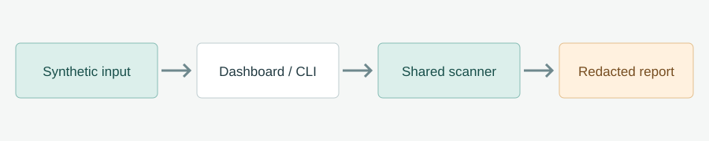
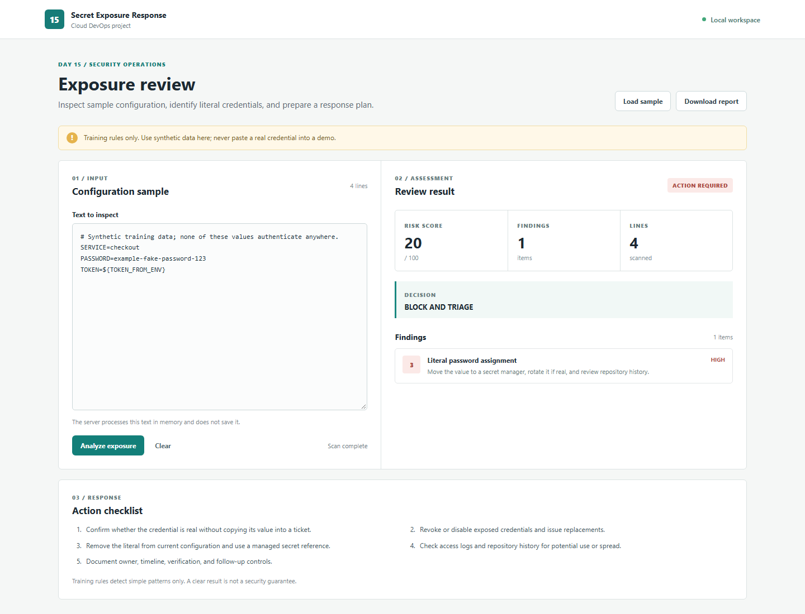

# Day 15 - Secret Exposure Response Dashboard

Build a local security operations tool that scans synthetic configuration for literal credentials, hides matched values, and produces a response plan. This is a new standalone project after the Day 14 hospital assistant, with the same app, validation, CI, and evidence workflow.

## Project Objective

A secret exposure requires more than deleting a line. Teams must identify the affected credential, rotate it, check whether it was used, and document the response without spreading the value further. This project practices that workflow with fake data.

## What You Will Build

```text
Synthetic config text
  -> browser dashboard or CLI
  -> shared Python scanner
  -> redacted findings and risk decision
  -> JSON / Markdown response report
  -> GitHub Actions validation
```

## Skills

- Build a small local HTTP API and static dashboard.
- Share one analysis engine between browser and CLI.
- Add unit tests for detection, false positives, and redaction.
- Validate risky and clean examples in CI.
- Capture evidence without revealing credential values.

## Architecture



See [architecture.md](./architecture.md) for trust boundaries and the Mermaid diagram.

## Folder Structure

```text
day-15-secret-exposure-drill/
  README.md
  architecture.md
  architecture.svg
  app/index.html
  app/styles.css
  app/app.js
  scan.py
  serve.py
  sample.env.txt
  sample-clean.env.txt
  scripts/run-demo.ps1
  scripts/run-demo.sh
  tests/test_scan.py
  reports/sample-report.json
  reports/sample-report.md
  screenshots/README.md
  screenshots/evidence/
```

## Quick Start On Windows

From this folder:

```powershell
.\scripts\run-demo.ps1
python serve.py
```

Open `http://127.0.0.1:8150/app/`. The page loads the synthetic sample and analyzes it automatically. Use **Clear**, change the value to an environment-variable reference, and analyze again. Press `Ctrl+C` in the server terminal when done.

## Quick Start On Linux Or macOS

```bash
bash scripts/run-demo.sh
python3 serve.py
```

Open `http://127.0.0.1:8150/app/`.

## CLI Report

```powershell
python scan.py sample.env.txt --output-json reports/scan-report.json --output-md reports/scan-report.md
```

The command returns exit code 1 for the risky sample. That is the expected gate result. `python scan.py sample-clean.env.txt` returns 0. Reports contain line numbers, rule names, and actions, but not matched values.

## Sample Result

The fake password on line 3 produces one high-severity finding and a `BLOCK AND TRIAGE` decision. The safe `${TOKEN_FROM_ENV}` reference is ignored. The included [sample report](./reports/sample-report.md) shows the expected output.

## Evidence



The [compact screenshot](./screenshots/evidence/02-mobile.png) shows the full response checklist. Use [screenshots/README.md](./screenshots/README.md) for the evidence checklist. Record a clean scan and the GitHub Actions result after running the project yourself.

## Break And Fix

1. Scan `sample.env.txt` and observe the blocked decision.
2. Replace `PASSWORD=example-fake-password-123` with `PASSWORD=${PASSWORD_FROM_SECRET_MANAGER}` in a copy.
3. Scan the copy and confirm there are no training-rule matches.
4. Explain why the real response would also require credential rotation and an access-log review.

## CI

`.github/workflows/day-15-secret-response.yml` runs unit tests, checks both fixtures, and uploads a redacted report artifact. It does not deploy to GitHub Pages because the repository already uses Pages for Day 14.

## Safety And Limits

This scanner is intentionally narrow. It is not a replacement for a maintained secret-scanning product or human review. Use only synthetic data in screenshots and demo input. The server listens on loopback, caps request size, processes text in memory, and does not persist scanned text.
