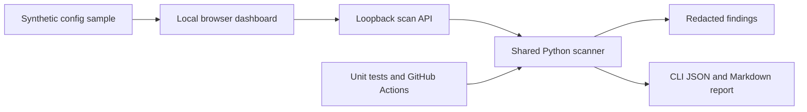

# Day 15 Architecture

The app and CLI share `scan.py`, so their decisions come from the same rules. The server binds only to `127.0.0.1` and processes input in memory. It returns line numbers and actions, never credential values. The browser can download a redacted JSON report. The CI workflow validates the scanner and uploads report artifacts; it does not deploy or modify cloud resources.

## Trust boundaries

- Input is untrusted. The API caps request bodies at 100 KB.
- Output contains metadata and response steps only. It never includes the matching value.
- Findings are rendered with DOM `textContent`, preventing sample input from becoming HTML.
- This training scanner has narrow rules. A no-match result cannot certify that a repository is secret-free.
