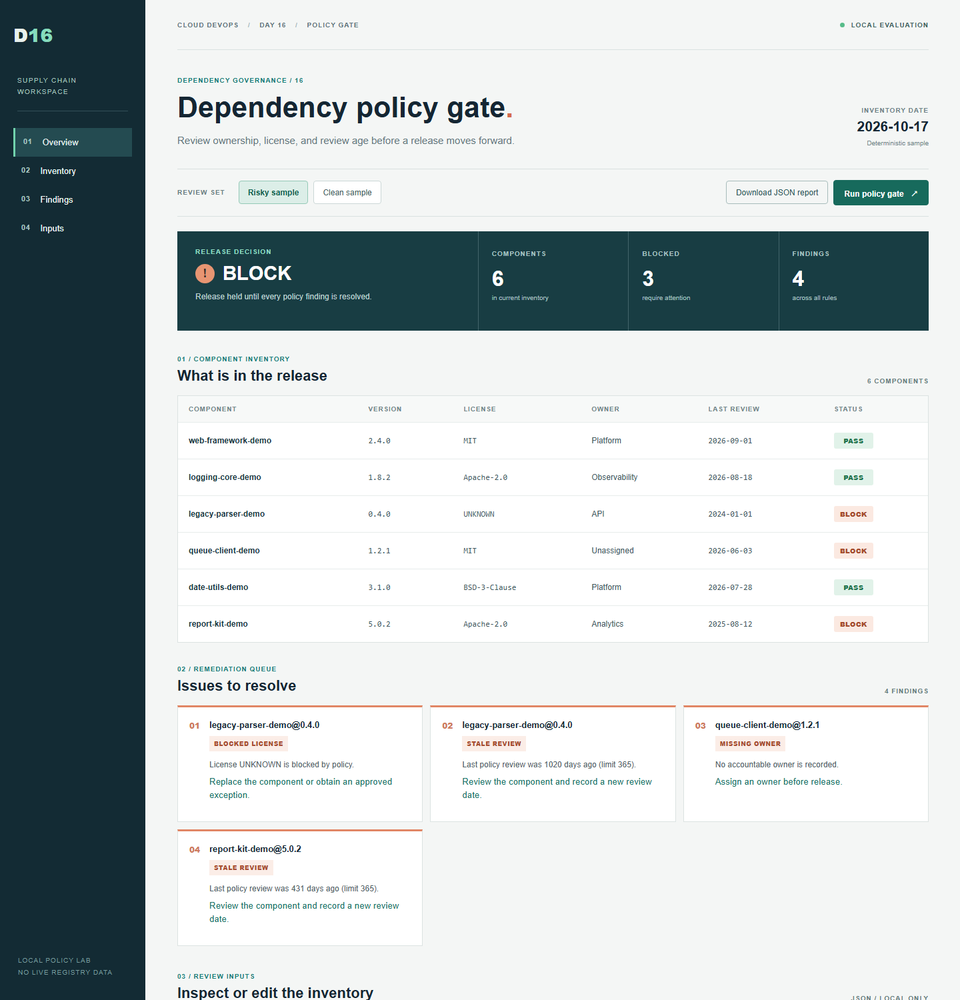

# Day 16 - Dependency Policy Gate

A complete local dependency-governance project built around an invented release
inventory. Review six components in the dashboard, run the same gate from the
CLI, and inspect a reproducible JSON or Markdown report. No cloud account,
container runtime, or third-party package is required.



## Run

From this folder:

```powershell
python serve.py
```

Open `http://127.0.0.1:8160/app/`. Switch between **Risky sample** and
**Clean sample**, or edit the inventory and policy JSON and run the gate again.
Download the evaluated report from the dashboard.

For the CLI and automated checks:

```powershell
python -m unittest discover -s tests -v
python check.py inventory-clean.json
python check.py inventory.json --output-json reports/policy-report.json --output-md reports/policy-report.md
./scripts/run-demo.ps1
```

The clean inventory exits 0. The risky inventory exits 1 and has four findings
across three components. Invalid input exits 2. The shell equivalent is
`bash scripts/run-demo.sh`.

## Policy and architecture

`policy.json` blocks `UNKNOWN` and `UNLICENSED` license identifiers,
requires an owner, and limits time since *policy review* to 365 days. The
inventory's fixed `as_of` date makes the example repeatable. See
[architecture.md](architecture.md) for the shared CLI/API flow. Sample output:
[JSON](reports/sample-policy-report.json) and
[Markdown](reports/sample-policy-report.md).

The dashboard and API bind only to loopback. Data is synthetic and stays local.
**This is not a live vulnerability scanner.** Review age does not establish
whether a package is vulnerable. Production use would require a generated SBOM,
maintained advisory data, legal/license review, and an approved exception process.

## Evidence

- [Dashboard](screenshots/evidence/01-dashboard.png)
- [Compact layout](screenshots/evidence/02-compact.png)
- [Successful CI run](screenshots/evidence/03-ci-success.png)
- [GitHub Actions workflow](../../.github/workflows/day-16-dependency-policy.yml)

## Troubleshooting

- Port 8160 occupied: stop the process using it before starting `serve.py`.
- Invalid JSON in the UI: correct the highlighted parse error, then run the gate.
- Exit 1 from the risky sample is expected; exit 2 means an invalid input.

## Cleanup

Stop the local server with Ctrl+C. No cloud resources are created.
